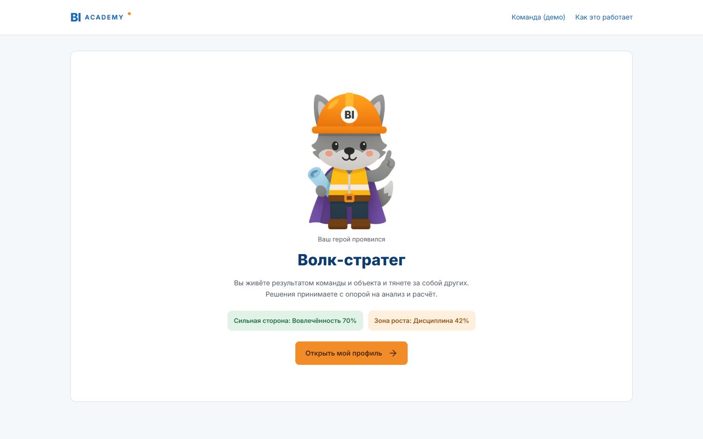
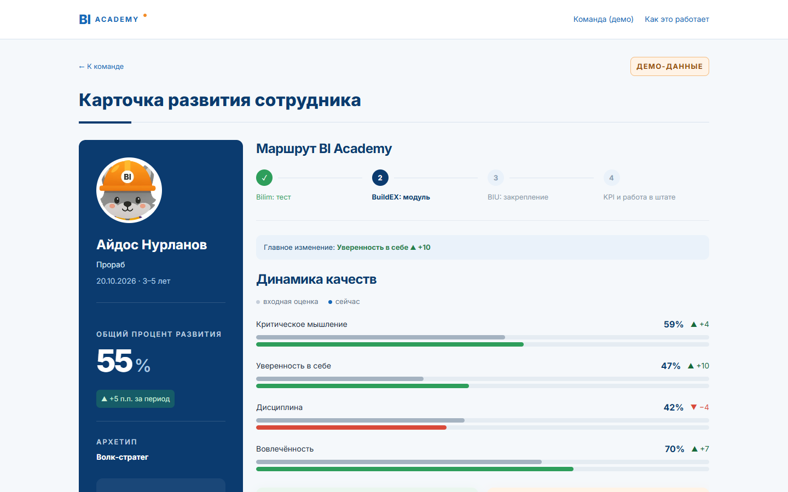
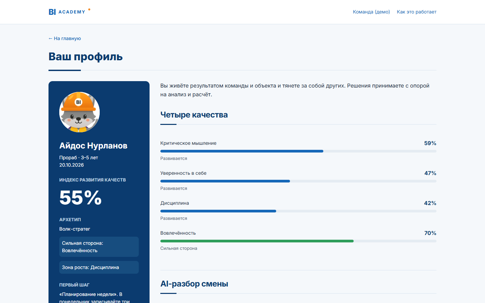
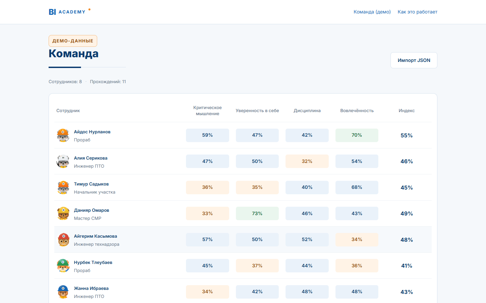
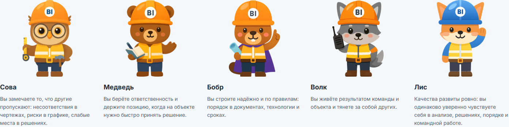

# Квест прораба · профиль качеств сотрудника

**[Открыть приложение → bi-foreman-quest.vercel.app](https://bi-foreman-quest.vercel.app)**

Одна смена на строительном объекте вместо анкеты: 15 решений в реальных рабочих ситуациях — и профиль четырёх качеств сотрудника с сильными сторонами, зонами роста, AI-разбором и планом развития на 30 дней.

Решение кейса **BI Group / BI Academy**: «Разработка системы анализа личностных качеств сотрудника» — тест из 15 вопросов по аналогии с 16Personalities, адаптированный под строительную отрасль.

<p align="center">
  
  
</p>

<p align="center"><br><sub>Отсканируйте, чтобы открыть с телефона</sub></p>

---

## Содержание

- [Попробовать за 2 минуты](#попробовать-за-2-минуты)
- [Что делает система](#что-делает-система)
- [Как устроен тест](#как-устроен-тест)
- [Как считается результат](#как-считается-результат)
- [Почему ответам можно доверять](#почему-ответам-можно-доверять)
- [Что видят сотрудник и руководитель](#что-видят-сотрудник-и-руководитель)
- [AI-разбор](#ai-разбор)
- [Данные и приватность](#данные-и-приватность)
- [Иллюстрации](#иллюстрации)
- [Технологии и архитектура](#технологии-и-архитектура)
- [Запуск локально](#запуск-локально)
- [Тесты и проверки](#тесты-и-проверки)
- [Деплой на Vercel](#деплой-на-vercel)
- [Ограничения и следующие шаги](#ограничения-и-следующие-шаги)

---

## Попробовать за 2 минуты

1. Откройте [приложение](https://bi-foreman-quest.vercel.app) → **«Начать смену»** → выберите каску → пройдите 2–3 сцены.
2. **«Команда (демо)»** → откройте карточку любого сотрудника: профиль, динамика и AI-подсказки руководителю доступны сразу.
3. **«Как это работает»** — методика подсчёта и раздел об AI.

Полное прохождение занимает около 10 минут. Есть **простой режим без игры** — те же вопросы, тот же результат.

---

## Что делает система

| Требование кейса | Как реализовано |
|---|---|
| Тест из 15 вопросов по аналогии с 16Personalities | 11 рабочих ситуаций + 4 утверждения со шкалой из 7 кружков, один вопрос на экран |
| Адаптация под строительство | Рабочий день прораба с 07:00 до 19:00: бетон, чертежи, высота, смежники, исполнительная, сроки |
| 4 качества в процентах | Критическое мышление, уверенность в себе, дисциплина, вовлечённость — 0–100% |
| Индивидуальный профиль | Архетип (например, «Бобр-стратег»), индекс развития, уровни по каждому качеству |
| Визуализация | Шкалы качеств, карточка развития, тепловая карта и средний радар команды |
| Сильные и слабые стороны | С цитатами из решений самого сотрудника — «почему такой результат» |
| Персональные рекомендации | Практика на объекте, модуль BI Academy, задание с наставником; план на 30 дней; AI-разбор |
| Профессиональное развитие | Повторное прохождение → динамика «входная оценка → сейчас»; маршрут Bilim → BuildEX → BIU → KPI |

---

## Как устроен тест

**Квест.** Сотрудник создаёт героя (каска и стиль смены; лицо скрыто знаком «?») и проживает смену. В каждой ситуации — сцена, реплика персонажа и 4 варианта действий. После решения показывается последствие, меняются игровые показатели объекта, на сцене растёт здание. Некоторые решения «отзываются» в следующих сценах. В конце смены — журнал решений, эпилог и **проявление героя**: силуэт превращается в архетип.

**Ситуации (11):**

| Время | Сцена | Время | Сцена |
|---|---|---|---|
| 07:00 | Планёрка: армирование не принято | 15:00 | Заказчик просит сдать этаж раньше |
| 08:30 | Приёмка бетона: смесь жиже обычного | 16:00 | Разбор ошибки в разбивке осей |
| 09:30 | Расхождение с чертежом на 40 мм | 17:30 | Исполнительная документация и КС-2 |
| 11:00 | Работа на высоте: нарушение подрядчика | 18:00 | Переход на цифровую приёмку |
| 12:30 | Смежники мешают друг другу | 19:00 | Предложение модуля BI Academy |
| 14:00 | Своя ошибка в заявке на арматуру | | |

**Утверждения (4)** — «паузы с наставником», по одному на качество, два из них сформулированы «наоборот» для проверки согласованности.

Полный банк вопросов с весами — в [`src/data/questions.ts`](src/data/questions.ts).

---

## Как считается результат

Проценты считает **прозрачная формула**, AI в подсчёте не участвует.

1. Каждый вариант ситуации даёт баллы 0–3 сразу по четырём качествам (матрица весов).
2. Утверждение по шкале 0–6 даёт 0–3 балла своему качеству (у обратных — `3 − v/2`).
3. Для каждого качества: `процент = round((баллы − минимум) / (максимум − минимум) × 100)`, где минимум и максимум вычисляются из самого банка вопросов.
4. **Индекс развития** — среднее четырёх процентов.

| Уровень | Диапазон |
|---|---|
| Требует развития | 0–39% |
| Развивается | 40–69% |
| Сильная сторона | 70–100% |

**Архетип** = животное по ведущему качеству + роль по второму: Сова (критическое мышление), Медведь (уверенность), Бобр (дисциплина), Волк (вовлечённость) × стратег / лидер / мастер / наставник — 12 сочетаний. Если качества развиты ровно (разброс ≤ 10 п.п.) — **Лис-«Универсал»**.

**Рекомендации** подбираются по правилам: для качеств ниже 55% — три шага (практика на объекте, обучение, наставник), уровень «низкий» или «средний»; план на 30 дней строится из рекомендаций самого слабого качества.

Код: [`src/lib/scoring.ts`](src/lib/scoring.ts), [`analysis.ts`](src/lib/analysis.ts), [`archetype.ts`](src/lib/archetype.ts), [`recommend.ts`](src/lib/recommend.ts). Подробно — на странице «Как это работает» в приложении.

---

## Почему ответам можно доверять

- **Нет правильного ответа.** Каждый вариант профессионально допустим, но проявляет разные качества. Формально проверено автотестом: ни один вариант не лучше другого сразу по всем четырём качествам.
- **Решение не переиграть.** Как на объекте: после «Принять решение» ответ фиксируется, кнопки «назад» нет, перезагрузка не помогает.
- **Контроль качества ответов.** Слишком быстрое прохождение, противоречивые или однообразные ответы на утверждения помечаются — с советом пройти заново. Проценты при этом не меняются.
- **Игра не искажает оценку.** Сюжет ветвится только в последствиях; вопросы и веса у всех одинаковые. Игровые показатели объекта (сроки, качество, безопасность, команда) в профиль не входят и руководителю не показываются. Совпадение игрового и простого режимов проверяется тестом на 50 наборах ответов.

---

## Что видят сотрудник и руководитель

**Сотрудник** — профиль: архетип и портрет, индекс развития, шкалы качеств, сильные стороны и зоны роста с примерами из своих решений, рекомендации, AI-разбор, план на 30 дней с отметками, PDF.

**Руководитель** — карточка развития: портрет, общий процент и динамика за период, шкалы «входная оценка → сейчас» с ▲/▼, сильные стороны и зоны роста, следующий шаг по маршруту BI Academy, AI-подсказки для разговора с сотрудником.

**Команда** — тепловая карта качеств, средний профиль команды, группы «кому что развивать» с модулем на группу, общий AI-анализ команды, импорт результатов в JSON.

| Профиль сотрудника | Команда |
|---|---|
|  |  |

---

## AI-разбор

AI **не считает и не меняет** проценты — он объясняет готовый результат человеческим языком.

- **Сотруднику:** итог, стиль принятия решений, «на что опереться» и «где рискуете» — со ссылками на конкретные ситуации и ответы, три действия на ближайшие недели.
- **Руководителю:** три подсказки, как работать с сотрудником.
- **Команде:** общие закономерности, риски и приоритеты обучения по обезличенным данным.

Как работает:
- Модель: `gpt-5.4-mini` (OpenAI), ответ по строгой JSON-схеме, обычно 4–7 секунд.
- Браузер отправляет на сервер **только** 15 ответов, должность и стаж из списков формы. Сервер сам пересчитывает проценты и архетип и сам собирает промпт из текстов банка вопросов — свободного текста от пользователя нет (защита от prompt injection).
- Имя и идентификатор результата в AI **не передаются**.
- Промпт запрещает выдумывать факты, ставить «диагнозы» и использовать местоимения рода; каждое утверждение подкрепляется ситуацией из данных.
- Ограничения: 6 запросов в час с одного IP, суточный лимит на экземпляр, кэш одинаковых прохождений, таймаут 25 с, один повтор при сбое. Если AI недоступен, профиль и правиловые рекомендации работают как обычно.
- Для демо-команды разборы подготовлены заранее и показываются без запросов к API.

Промпт и схема: [`server/reference.json`](server/reference.json), обработчик — [`server/analyze.ts`](server/analyze.ts).

---

## Данные и приватность

- Прогресс и результаты хранятся **только в браузере** (`localStorage`). Сервер их не сохраняет.
- Кнопка **«Удалить мои данные»** в подвале очищает прогресс, результаты, планы и кэш разборов.
- В AI уходят только ответы, должность и стаж — без имени.
- Ключ OpenAI хранится только в переменных окружения сервера Vercel; в коде, репозитории и браузерных файлах его нет (проверяется `npm run check:dist`).
- Все имена в демо-команде вымышлены.

---

## Иллюстрации

Персонажи нарисованы в стиле лиса-прораба из материалов BI Academy: плоская векторная графика с мягкими градиентами, пропорции «чиби», каска со значком BI.

- **13 архетипов** (12 сочетаний животное + роль и Лис-«Универсал»), **герой-«загадка»** и **10 персонажей-людей** сгенерированы `gpt-image-1` по единому стилевому промпту.
- **6 цветов касок** для каждого архетипа получены не повторной генерацией, а **локальной перекраской**: скрипт выделяет каску и меняет её оттенок, сохраняя светотень и значок; альфа-канал совпадает с базой бит в бит.
- Постобработка удаляет тени и артефакты, заливает значки, режет портреты 600×900 и аватары 256×256 в WebP.
- Роль видна по предмету: стратег — плащ и чертёж, лидер — рация, мастер — рулетка и молоток, наставник — блокнот. У подрядчиков на касках нет значка BI.

Конвейер: [`scripts/art/`](scripts/art/). Готовые изображения — [`public/art/`](public/art/) (188 WebP, ~12 МБ). Сырые генерации и референсы в репозиторий не входят.



---

## Технологии и архитектура

| Слой | Технологии |
|---|---|
| Интерфейс | React 18, TypeScript (strict), Vite 6, Tailwind CSS, React Router (HashRouter), Recharts, lucide-react |
| Сцена квеста | Inline SVG + CSS-анимации, учёт `prefers-reduced-motion` |
| Сервер | Функции Vercel (Node 22): `/api/analyze`, `/api/team-analyze`, `/api/health` |
| AI | OpenAI Chat Completions, structured outputs (JSON Schema) |
| Тесты | Vitest, Playwright (браузерные сценарии), Lighthouse |

```
app/
├── api/                  # собранные функции Vercel (генерируются из server/routes, коммитятся)
├── server/               # исходники серверной части: analyze, team-analyze, http, лимиты, схема
│   └── routes/           # точки входа функций
├── src/
│   ├── data/             # банк вопросов, архетипы, рекомендации, квест, демо-команда, демо-разборы
│   ├── lib/              # подсчёт, анализ, архетип, рекомендации, флаги, хранилище, квест, AI-клиент
│   ├── components/       # дизайн-система (ui/), сцена квеста, результат, руководитель, команда
│   ├── pages/            # главная, квест, классический тест, результат, руководитель, команда, методика
│   └── tests/            # unit- и интеграционные тесты
├── public/art/           # иллюстрации WebP
├── scripts/              # сборка api, арт-конвейер, браузерные проверки, скриншоты, QR
└── screenshots/          # скриншоты для README и QR
```

Маршруты: `/#/` · `/#/quest/start` · `/#/test/start` · `/#/result/:id` · `/#/manager/:id` · `/#/team` · `/#/method`.

**Почему функции собираются в `api/*.js`.** Проект — ES-модуль (`"type": "module"`), а Vercel компилирует каждый файл функции отдельно и не связывает импорты без расширений. Поэтому `npm run build:api` (esbuild) собирает каждую функцию из `server/routes/*.ts` в один самодостаточный файл `api/*.js`. Сборка запускается автоматически в начале `npm run build`.

---

## Запуск локально

Нужны Node.js **22.x** и npm 10+.

```bash
npm ci
npm run dev
```

Откройте http://127.0.0.1:5173.

**AI локально** (необязательно): задайте серверную переменную окружения `OPENAI_API_KEY` (и при желании `OPENAI_MODEL`). Dev-сервер подключает тот же обработчик `/api/analyze`, что и Vercel. Без ключа приложение работает полностью, кроме живого AI-разбора; демо-разборы показываются всегда. Переменные с ключом **никогда** не называйте `VITE_*` — они попадут в браузер.

**Сборка:**

```bash
npm run build      # api/*.js + проверка типов + Vite
npm run preview    # статическая версия (живой API — в npm run dev или на Vercel)
```

| Команда | Что делает |
|---|---|
| `npm run dev` | Dev-сервер с локальным `/api/*` |
| `npm run build` | Сборка функций и фронтенда |
| `npm run build:api` | Только сборка функций в `api/*.js` |
| `npm run lint` | ESLint |
| `npm run test` | Vitest: unit- и интеграционные тесты |
| `npm run check:dist` | Проверка, что в сборке нет ключей |
| `npm run test:quest-browser` | Полный квест в браузере (360 и 1440 px) |
| `npm run test:scene-browser` | Сцена, анимации, темы, reduced-motion |
| `npm run test:dashboard-browser` | Команда, карточки, импорт, методика |
| `npm run test:ai-browser` | AI-блоки на заглушках (без платных запросов) |
| `npm run ai:demo` | Пересоздать демо-разборы (нужен ключ, обращается к API) |

Браузерные проверки запускаются против `npm run preview` / `npm run dev`; адрес задаётся `BI_PREVIEW_URL`, путь к Chrome/Edge — `BI_BROWSER_PATH`.

---

## Тесты и проверки

- **Автотесты** (Vitest): утверждённый контент (снимок текстов и весов), банк вопросов и веса, отсутствие доминирующих вариантов, формула и нормировка, архетипы, рекомендации, флаги, хранилище и миграции, совпадение игрового и простого режимов, неизменность ядра подсчёта (SHA-256), иллюстрации и перекраска, серверный AI-обработчик (валидация, лимиты, кэш, схема ответа).
- **Браузерные сценарии** (Playwright) на 360–1440 px: полное прохождение, перезагрузка без возможности переответить, анимации и их пропуск, PDF, отсутствие ошибок в консоли и горизонтальной прокрутки.
- **Lighthouse (mobile):** Performance 84, Accessibility 100.
- **CI** ([`.github/workflows/ci.yml`](.github/workflows/ci.yml)): `npm ci`, lint, test, build, check:dist на каждый push.

---

## Деплой на Vercel

1. Импортируйте репозиторий в Vercel (Framework: **Vite**, Root Directory: `.`, Build: `npm run build`, Output: `dist`, Node 22.x).
2. Добавьте серверные переменные окружения:

   | Переменная | Значение |
   |---|---|
   | `OPENAI_API_KEY` | ключ OpenAI (отдельный для проекта, с лимитом расходов) |
   | `OPENAI_MODEL` | `gpt-5.4-mini-2026-03-17` |
   | `AI_DAILY_LIMIT` | `300` |

3. **Deploy.** Проверка: `https://<project>.vercel.app/api/health` → `{"ai":true}`.

Подробная пошаговая инструкция — [DEPLOY_VERCEL.md](DEPLOY_VERCEL.md).

---

## Ограничения и следующие шаги

Это **скрининговый инструмент** для развития, а не валидированная психометрическая методика и не оценка сотрудника.

- При случайных ответах средние значения качеств различаются на несколько пунктов (дисциплина ниже на 3–5 п.п.) — сравнивать качества между собой стоит осторожно.
- AI может ошибаться в формулировках; проценты и рекомендации по методике от него не зависят.
- Лимиты и кэш AI хранятся в памяти экземпляра функции и сбрасываются при перезапуске.

Для внедрения в BI Group:
1. **Пилот** на 50–100 сотрудниках: согласованность шкал (α Кронбаха), сопоставление с оценкой руководителей.
2. **Калибровка:** переход от процентов к нормам по выборке BI Group (процентилям), уточнение весов.
3. **Интеграция:** вход через учётную запись Bilim, хранение результатов на сервере, реальный каталог модулей BI Academy, казахский язык, наборы ситуаций для других ролей (мастер, ПТО, технадзор).

---

<sub>Проект подготовлен для кейс-чемпионата BI Group. Названия модулей BI Academy в рекомендациях — примерные. Иллюстрации сгенерированы AI по стилю материалов кейса.</sub>
